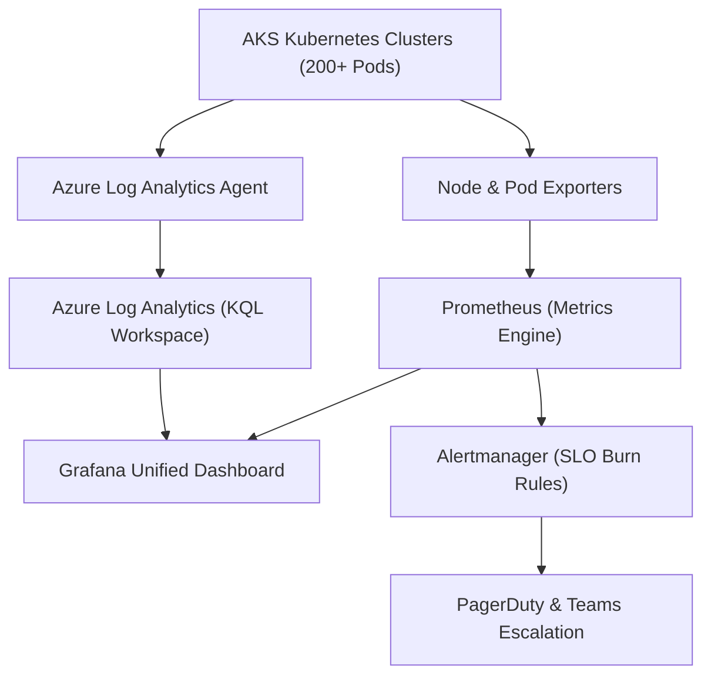

<div align="center">

# 📊 Enterprise SRE Observability & Telemetry Platform

**Full-Stack Centralized Observability with Prometheus, Grafana, Azure Monitor, Log Analytics & SLI/SLO Governance**

[](https://prometheus.io/)
[](https://grafana.com/)
[](https://azure.microsoft.com/)
[](https://azure.microsoft.com/)

</div>

---

## 📌 Project Overview

This repository captures the production **Site Reliability Engineering (SRE) & Observability** architecture implemented at **Reliance Industries Limited (RIL)** across 100+ production microservices. It bridges the gap between infrastructure metrics, application traces, centralized logging, and business SLIs/SLOs to minimize Mean Time to Resolution (MTTR) and prevent customer-impacting outages.

### 🌟 Key Responsibilities & Capabilities:
- **Centralized Metrics Aggregation:** Prometheus scraping Kubernetes nodes, pods, and custom application metrics endpoints.
- **SLI/SLO & Error Budgeting:** Mathematically defined 99.9% availability targets and multi-window burn rate alert rules.
- **Advanced Log Analytics (KQL):** Production Kusto Query Language queries analyzing container crashes and request failures.
- **Incident Routing & Self-Healing:** Automated alert rules routed to PagerDuty and Teams with diagnostic remediation scripts.
- **Unified Grafana Dashboards:** Executive health, infrastructure utilization, and microservice Golden Signals (Latency, Traffic, Errors, Saturation).

---

## 🏛️ Observability Mesh Architecture



---

## 📂 Project Structure

```
sre-observability-platform/
├── prometheus/
│   ├── prometheus.yml            # Scrape configurations & service discovery
│   └── alerts/
│       ├── slo-rules.yml         # Fast/Slow error budget burn rate alerts
│       └── infrastructure-alerts.yml # Node disk, memory & pod crashloop alerts
├── grafana/
│   ├── datasources/
│   │   └── datasource.yml        # Multi-datasource definitions (Prometheus + Azure Monitor)
│   └── dashboards/               # Custom Grafana dashboard JSON models
├── azure-monitor/
│   └── kql-queries/
│       ├── failed-requests.kql   # Application Insights failure analysis
│       └── container-log-analysis.kql # OutOfMemory & fatal exception detector
├── sli-slo/
│   └── service-level-objectives.yaml # 99.9% availability & <200ms latency specifications
├── scripts/
│   └── alert-simulator.py        # Automated synthetic incident generator
└── README.md
```

---

## 🏆 Business Impact & Achievements
- **MTTR Reduction:** Slashed Mean Time to Resolution from 45 minutes to under 8 minutes via automated root-cause queries.
- **Proactive Detection:** Detected 92% of operational degradations prior to customer SLA impact.
- **SLA Attainment:** Consistently sustained 99.95%+ platform uptime backed by real-time error budget tracking.

---

**Author:** [Anil Kumar](https://www.linkedin.com/in/anil-kumar-58a08b3b4/) | Senior DevOps & Cloud Engineer
